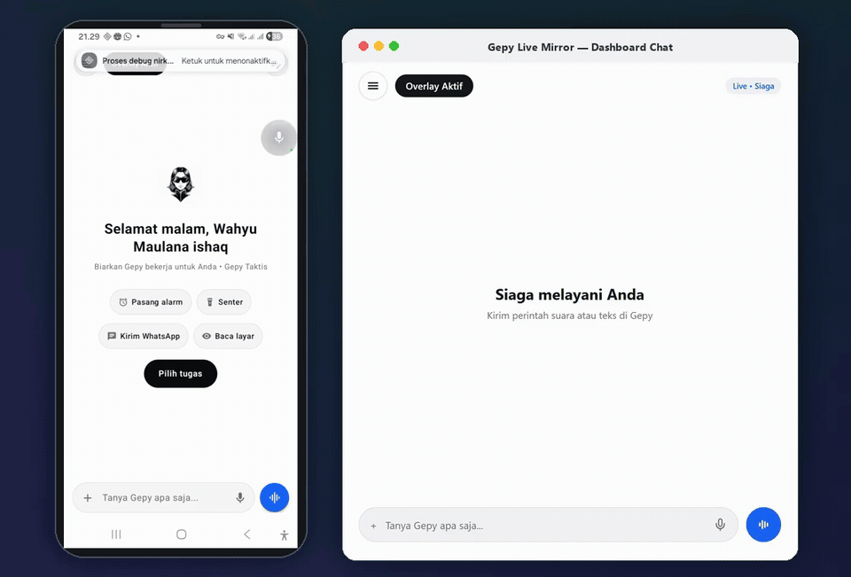

<div align="center">

  <picture>
    <source media="(prefers-color-scheme: dark)" srcset="docs/media/gepy-hero-dark.png">
    <source media="(prefers-color-scheme: light)" srcset="docs/media/gepy-hero-light.png">
    
  </picture>

  <p>
    <strong>An AI assistant on your Android phone: say what you need, and it operates real apps on your screen until it's done.</strong><br />
    Native Kotlin &amp; Jetpack Compose with deterministic safety gates, local <strong>Room v6</strong> memory, and a <code>&lt;240 MB PSS</code> budget tuned for 4 GB RAM devices without an NPU.
  </p>

  <p>
    <a href="https://github.com/wmaulanaaishq/gepy-app/actions/workflows/android-ci-cd.yml"></a>
    <a href="CHANGELOG.md"></a>
    <a href="CHANGELOG.md"></a>
    <a href="CHANGELOG.md"></a>
    <a href="scripts/evals/runner.py"></a>
    <a href="docs/DEVICE_PROFILE.md"></a>
    <a href="LICENSE"></a>
  </p>

  <p>
    <a href="#what-gepy-can-do">Capabilities</a>
    &nbsp;&middot;&nbsp;
    <a href="#quick-start">Quick Start</a>
    &nbsp;&middot;&nbsp;
    <a href="docs/ARCHITECTURE.md">Architecture</a>
    &nbsp;&middot;&nbsp;
    <a href="docs/MODELS.md">Models</a>
    &nbsp;&middot;&nbsp;
    <a href="docs/DEVICE_PROFILE.md">Galaxy A06 Profile</a>
    &nbsp;&middot;&nbsp;
    <a href="#privacy-and-safety">Privacy &amp; Safety</a>
  </p>

  <br />

  

</div>

> **Real-time recording on Samsung Galaxy A06 (`SM-A065F`, `1.0×` speed, `3.75 MB`, `45.3s` to HITL `Book`):** *"pesankan gojek ke universitas alma ata"* (*"book a Gojek ride to Universitas Alma Ata"*)  
> **Left (`Device`):** Executes from an idle home screen via Accessibility Tree + Overlay HUD and pauses at **HITL confirmation (`Konfirmasi Aksi (Book)` + `Batalkan / Eksekusi`)** before tapping **`Book Rp12.500`**.  
> **Right (`Mirror`):** **Gepy Live Mirror** (`BuildConfig.DEBUG` loopback via [`GepyStateMirrorServer`](app/src/main/kotlin/com/teknologigawai/gepy/core/diagnostics/GepyStateMirrorServer.kt)) streaming the timeline steps, elapsed timer, and the monochrome **Safety Confirmation Required** (*Konfirmasi Keamanan Diperlukan*) card in sync.

```text
· user: "pesankan gojek ke universitas alma ata"
│
· read AccessibilityTree (fallback: 720px Set-of-Marks) + SingleAgentReAct
│
· launch("com.gojek.app") -> focus_type -> select route -> GoRide
│
· SafetyRules HITL lock on "Book Rp12.500" -> await [Execute / Cancel]
```

---

## What Gepy Can Do

> Built-in **BYOK (Bring Your Own Key)** mode can be configured without rebuilding the APK via **Settings > AI Models & API Keys** (*Pengaturan > Model AI dan kunci API*), or compiled as defaults via `local_secrets.json`.

| Capability | How It Works |
|---|---|
| **Autonomous App Control** | Parses the live UI tree (*Accessibility Tree*), taps, long-presses, types safely (**Focus Before Type**), scrolls, copies/pastes, and navigates home via `11` action primitives and local **Playbook Fast-Paths**. |
| **Conditional Screen Vision** | Captures **Set-of-Marks** screenshots (`<= 720px`, JPEG `72%`, `64-bit dHash` deduplicated) for multimodal reasoning only when hitting custom canvas blind spots or unlabeled elements. |
| **Full-Duplex Voice & Cloning** | Real-time bidirectional voice calls over **Gemini 3.8 Live**, zero-key on-device voice commands via **Android `SpeechRecognizer` (`id-ID`)**, and personalized **ElevenLabs (`eleven_v4_turbo`)** replies with `SHA-256` deduplicated local MP3 caching. |
| **Floating Bubble-Up HUD** | Translucent floating glass orb above any app (`tap` for quick voice command, `long-press` for Live Call) that expands into an animated **dark smoked glass** card paired with a crisp white status capsule and Stop button. |
| **Hybrid Memory & OS Verifiers** | Recalls personal facts and multi-session context using **Tri-Gram BM25+**, temporal graph decay (*Identity Shield* + *Ebbinghaus*), and `gemini-embedding-2` vectors (`<= 1,000` in RAM / `<= 2,500` SQLite rows), plus native Android verification of alarms, calendar, contacts, and downloads. |
| **Wrong-Tap Prevention (SEWM)** | **Symbolic Edge World Model** (`ui_transition_rules`, `< 0.1 ms` RAM lookup) predicts paywalls, ad popups, system permission prompts, or dead ends before an action touches the screen. |
| **Real-Time Web Research** | Researches live facts and reads long-form pages via **Google Search Grounding**, Jina Reader, and Wikipedia directly inside chat or voice without hijacking your foreground app. |
| **Adaptive Personas & Guardian** | Switchable personalities (**Adaptive**, **Gepy Tactical & Efficient**, **Honest & Strict Mentor**, **Playful Partner**, or **Custom**), paired with hardware pedometer (`TYPE_STEP_COUNTER`), doomscrolling alerts, *Morning Briefing*, and *Evening Reflection*. |
| **Laptop, MCP & Camera-Free IoT** | LAN/Tailscale bridge to the Windows daemon [`scripts/laptop_companion`](scripts/laptop_companion/gepy_laptop_daemon.py) (`:8888`), Python MCP worker [`scripts/mcp_server`](scripts/mcp_server/server.py) (`:8000`), and **ESP32-S3 Wi-Fi CSI** presence radar (`:8765`) for camera-free awareness. |

By default, **`SafetyRules`** intercepts every sensitive or transactional step and enforces a deterministic **Human-in-the-Loop (HITL)** pause before tapping irreversible controls such as **`Send` / `Kirim`**, **`Save` / `Simpan`**, **`Delete` / `Hapus`**, **`Pay` / `Bayar`**, **`Checkout`**, or **`Book`**.

<details>
<summary>Supported AI Models, Live Audio, and Voice Engines</summary>

| Role | Provider / Engine | Models & Notes |
|---|---|---|
| **ReAct Reasoning & Chat** | Fireworks AI / Google Gemini / AI/ML API & Custom OpenAI / Azure | `accounts/fireworks/models/deepseek-v4p1-flash`, `glm-5p3-flash`, `gpt-oss-120b`, `gemini-3.1-flash-lite`, `gemini-2.5-flash`, `google/gemini-3.1-flash-lite` (1-tap `ByokProviderPreset.AIML_API`), OpenRouter / Groq / DeepSeek (`CUSTOM_OPENAI`) & Azure OpenAI with per-provider circuit breakers |
| **Full-Duplex Live Voice** | Google Gemini Live (`BidiGenerateContent`) | `gemini-3.8-live` and `gemini-3.8-live-extended-thinking` (24kHz native PCM audio) |
| **Multimodal & Vision (SoM)** | Google Gemini | `gemini-2.5-flash` / `gemini-3.8-flash` |
| **Semantic Vector Memory** | Google Gemini Embedding | `gemini-embedding-2` (768-dim MRL, L2-normalized Float32 BLOB) |
| **Speech-to-Text (STT)** | Android Native On-Device | Android `SpeechRecognizer` (`id-ID`) with zero API key overhead and resilient network behavior |
| **Custom Voice TTS** | ElevenLabs API `v1` | `eleven_v4_turbo` (default), `eleven_flash_v2_5`, `eleven_v4` + **Voice Vault `.zip`** (SAF backup/restore) |

Dual-key quota isolation and automatic failover (`GeminiKeyPool`) are documented in [`docs/MODELS.md`](docs/MODELS.md).

</details>

<details>
<summary>System Architecture and 4 GB RAM Budget</summary>

- **Single-Process Zero-Isolate:** `GepyAccessibilityService`, `GepyOrchestrator`, `VoiceAudioEngine`, `EspCsiAmbientBridge`, `WellnessAndGuardianEngine`, and `OverlayHudWindowManager` share a single Android ART process communicating directly via `StateFlow` (`0 ms` IPC overhead).
- **Hexagonal Ports & Adapters:** Core cognition is isolated behind 6 interfaces (*Perception*, *Brain*, *Action*, *Memory*, *VoiceHud*, *OsStateVerifier*) for deterministic JVM verification.
- **4 GB RAM Ceiling:** Live PSS monitoring via [`RuntimeMemoryDiagnostics`](app/src/main/kotlin/com/teknologigawai/gepy/core/diagnostics/RuntimeMemoryDiagnostics.kt), vector cache bounded to `<= 1,000` vectors in RAM / `<= 2,500` SQLite rows, SEWM bounded to `<= 2,000` rules (`< 1.5 MB`), and **Set-of-Marks** `Bitmap` buffers (`<= 720px`) recycled immediately with `Bitmap.recycle()`.

</details>

---

## Quick Start

### 1. Prepare API Keys (Optional at build time — editable anytime via in-app BYOK)

```powershell
Copy-Item local_secrets.example.json local_secrets.json
# Optionally populate Gemini / Fireworks / Custom / ElevenLabs keys for compile-time defaults
```

### 2. Run Quality Gates & Build APKs

```powershell
# Runs 468 JVM unit tests (68 suites), Android Lint, and assembleDebug
powershell -ExecutionPolicy Bypass -File .\scripts\verify.ps1

# Assembles Release R8 APK + Debug APK + Release AAB into dist/
powershell -ExecutionPolicy Bypass -File .\scripts\build_release.ps1
```

### 3. Install onto Your Android Device

```powershell
adb install -r dist\app-release.apk
```

| Optional Extension | How to Run / Configure |
|---|---|
| **In-App BYOK Config** | Open the navigation drawer **Settings > AI Models & API Keys** (*Pengaturan > Model AI dan kunci API*) to switch Gemini, AI/ML API (`ByokProviderPreset.AIML_API`), Fireworks, Custom OpenAI, Azure, or ElevenLabs keys without rebuilding. |
| **MCP Satellite Worker** | Start [`scripts/mcp_server/server.py`](scripts/mcp_server/server.py) on `:8000` over Tailscale/LAN (`tools`: web extraction, PDF/CSV inspection, Python sandbox). See [`scripts/mcp_server/README.md`](scripts/mcp_server/README.md). |
| **Windows Laptop Companion** | Start [`scripts/laptop_companion/run_daemon.ps1`](scripts/laptop_companion/run_daemon.ps1) for hybrid desktop control and the A2A M2M bridge on `:8888`. |
| **ESP32-S3 Wi-Fi CSI Sensor** | Connect an ESP32-S3 node on the same 2.4 GHz Wi-Fi LAN (`AP Client Isolation` disabled) at `:8765`. See [`iot/esp32_s3_csi/README.md`](iot/esp32_s3_csi/README.md). |
| **Cloudflare Edge Gateway** | Optional edge gateway & Supabase `pgvector` deployment. See [`backend/cloudflare-worker/README.md`](backend/cloudflare-worker/README.md). |

---

## Supported Devices

| Specification | Requirement |
|---|---|
| **Operating System** | **Android 10+** (`minSdk 29`, `targetSdk 35`); live-verified on **Samsung Galaxy A06 (`SM-A065F`, 4 GB RAM, Android 14/15/16)** |
| **CPU Architecture** | `arm64-v8a` and `armeabi-v7a` (no NPU required) |
| **Accessibility Permissions** | On sideloaded Android 14+ builds, open **App Info (Gepy) > top-right 3-dot menu > Allow restricted settings**, then enable **Accessibility Service** and **Display over other apps** |
| **Background Survival** | On Samsung One UI, set **Battery > Unrestricted** so system memory management does not terminate the overlay service |

Detailed device telemetry profiles and wireless ADB debugging guides live in [`docs/DEVICE_PROFILE.md`](docs/DEVICE_PROFILE.md).

---

## Privacy and Safety

- **Hardware-Backed Local BYOK Encryption:** All user-entered API keys are stored locally encrypted with **Android Keystore `AES-256-GCM`** ([`ByokPreferencesManager.kt`](app/src/main/kotlin/com/teknologigawai/gepy/core/config/ByokPreferencesManager.kt)); conversation history, memories, and playbooks reside locally inside **Room SQLite (`gepy_core.db`)**.
- **Permanent Financial & Credential Blocklist:** [`SafetyRules.kt`](app/src/main/kotlin/com/teknologigawai/gepy/core/config/SafetyRules.kt) strictly blocks reading or interacting with m-Banking and e-Wallet apps (`com.bca`, `id.bmri.livin`, `id.co.bri.brimo`, `id.dana`, `ovo.id`, `com.gojek.gopay`, etc.), OS permission dialogs, Play Store / Galaxy Store checkouts, and every `PIN`, `Password`, or `OTP` input field — **even when *Sovereign Personal Mode* is enabled**.
- **Human-in-the-Loop (HITL) Confirmation Gate:** Irreversible or catastrophic actions (`Send`, `Delete`, `Pay`, `Transfer`, `Checkout`, `Book`) pause automatically and require an explicit **`Execute` (`Eksekusi`)** tap from the user.
- **Ephemeral Screen Parsing & Gated Microphone:** UI accessibility trees are processed transiently in memory only during an active goal, and audio capture activates strictly on push-to-talk or explicit Live Call sessions.

Read the complete policy in [`docs/PRIVACY_POLICY.md`](docs/PRIVACY_POLICY.md).

---

## Documentation and Quality Gates

<details>
<summary>Documentation Hub and Repository Layout</summary>

| Document / Path | Purpose |
|---|---|
| [`docs/ARCHITECTURE.md`](docs/ARCHITECTURE.md) | Hexagonal **v6.6.0** architecture blueprint, package map, Room `v6` schema, OS-State Verifiers, and SEWM |
| [`CHANGELOG.md`](CHANGELOG.md) | Release history, engineering milestones, and verified quality gate summaries |
| [`LICENSE`](LICENSE) & [`NOTICE`](NOTICE) | PolyForm Noncommercial 1.0.0 license terms and copyright attribution |
| [`docs/DEVICE_PROFILE.md`](docs/DEVICE_PROFILE.md) | Samsung Galaxy A06 (`SM-A065F`) hardware profile, PSS budget, One UI survival, and Wireless ADB |
| [`docs/MODELS.md`](docs/MODELS.md) | Verified upstream model IDs across Google Gemini, Fireworks AI, AI/ML API presets, ElevenLabs, and Native STT |
| [`docs/PRIVACY_POLICY.md`](docs/PRIVACY_POLICY.md) | Privacy policy, Accessibility API compliance, and user data deletion controls |

```text
gepy-app/
├── app/
│   ├── src/main/kotlin/com/teknologigawai/gepy/
│   │   ├── core/               # Config, SafetyRules, Diagnostics, Ports, Persona, Wellness, IoT CSI, Laptop A2A, Web, Memory, OS Verifiers, Skills
│   │   ├── data/database/      # Room SQLite v6 (Playbooks, SEWM, Episodic Lessons, Wellness, Temporal Facts, Memory Vectors)
│   │   ├── features/           # Orchestrator, Brain (ReAct+SoM+SEWM), Perception (dHash), Action, Voice (Live 3.8 + ElevenLabs), Overlay
│   │   ├── service/            # AccessibilityService, VoiceForegroundService, NightlyConsolidationJob, QuickTile
│   │   └── ui/                 # MainActivity, DashboardScreen, AssistantCanvasComponents, Drawer, FeatureSheets, WelcomeAuth
│   └── src/test/kotlin/        # 68 Test Suites (468 deterministic JVM unit tests)
├── backend/cloudflare-worker/  # Edge AI Gateway, Auth JWT, Web Search & Supabase pgvector
├── iot/esp32_s3_csi/           # ESP32-S3 Wi-Fi CSI firmware & hardware setup guide
├── scripts/                    # PowerShell verify & release, demo mirror, gepy-eval, mcp_server, laptop_companion
├── docs/                       # Documentation hub & demo media assets
└── dist/                       # Built release/debug APK & AAB artifacts (+ dist/archive/ rollback)
```

</details>

<details>
<summary>Latest Quality Gates (v6.6.0)</summary>

| Check | Scope | Result |
|---|---|---|
| **JVM Unit Tests** | `scripts/verify.ps1` (`./gradlew testDebugUnitTest`) across **68 test suites** | **468 / 468 Passing** (`0` failures, `0` skipped) |
| **Android Lint** | Static code & SDK security analysis (`./gradlew lintDebug`) | **0 Errors** |
| **Gepy-Eval Gate** | `python scripts/evals/runner.py --mode quick` | **36 / 36 Passing** |
| **R8 Release Artifacts** | `scripts/build_release.ps1` in `dist/` | **Release APK `26.05 MB`**, **Debug APK `92.26 MB`**, **Release AAB `16.61 MB`** |
| **Galaxy A06 Physical Run** | *"pesankan gojek ke universitas alma ata"* end-to-end | **Passed end-to-end** to **HITL (`Konfirmasi Aksi (Book)`)** (`Batalkan / Eksekusi`) before `Book Rp12.500` (`45.32s` via AI/ML API `google/gemini-3.1-flash-lite`; verified via `/state`, `logcat`, and synchronous dual-screen recording) |

</details>

<details>
<summary>FAQ</summary>

- **Does the phone need root access or an NPU?**  
  No. Gepy runs on standard non-rooted Android 10+ devices and is engineered to run smoothly on 4 GB RAM devices without an NPU.

- **Why is the Accessibility Service toggle greyed out after installing the APK?**  
  That is Android 14+'s Restricted Settings safeguard for sideloaded APKs. Open **Settings > Apps > Gepy > top-right 3-dot icon > Allow restricted settings**, then re-enable Gepy under Accessibility.

- **Can I run Gepy without hosting a dedicated backend server?**  
  Yes. Enter your own API keys (**BYOK**) in **Settings > AI Models & API Keys** and Gepy connects directly to your chosen provider with zero middleware server required.

- **How do I wipe stored memories, cached voice audio, and local history?**  
  Use **Clear All** in **Rules & Playbooks**, **Clear Cache** under **Settings > Voice**, **Delete Cloud Memory History** in **Settings** (when signed into Google), or uninstall the app to purge `gepy_core.db` completely.

</details>

---

## Maintainer and License

Developed by wahyu maulana ishaq.  
Licensed under [**PolyForm Noncommercial 1.0.0**](LICENSE) (see [`NOTICE`](NOTICE)). Commercial distribution, rebranding, or paid hosting requires prior written permission.
