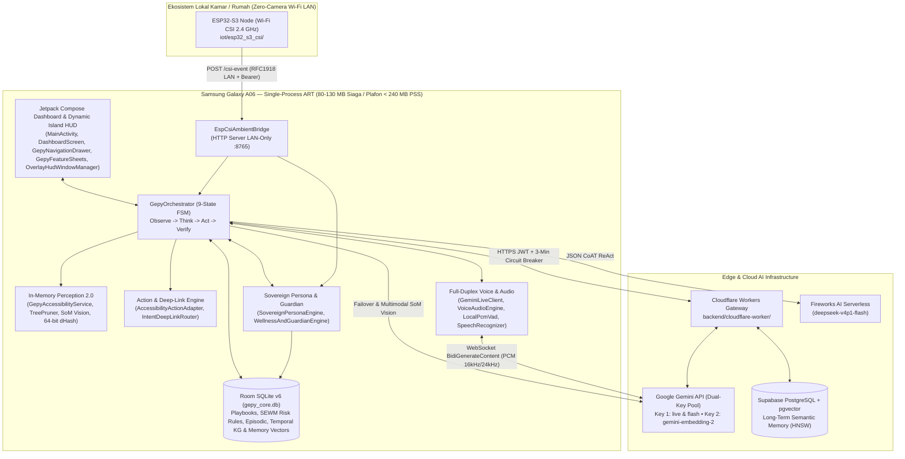
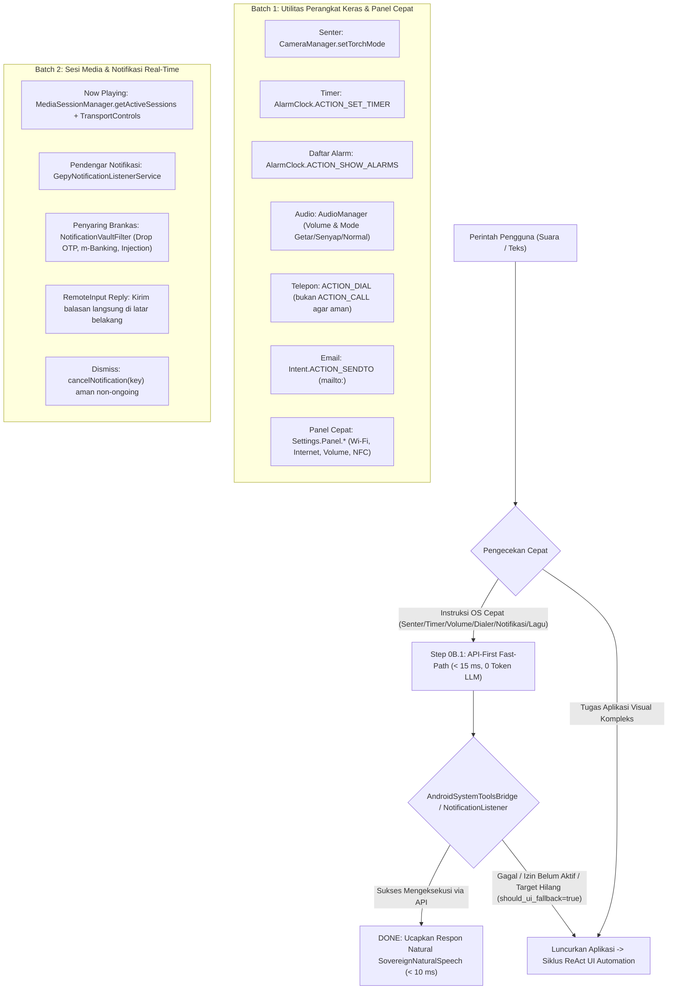

# Arsitektur Sistem — Gepy Native v6.6.0 (`com.teknologigawai.gepy`)

Dokumen ini adalah referensi arsitektur teknis utama (**mandiri / self-contained**) untuk **Gepy Native v6.6.0 — Sovereign Superintelligence Mobile-Use Personal AI Agent**. Seluruh modul berjalan di atas **100% Pure Native Android (Kotlin + Jetpack Compose)** tanpa ketergantungan Flutter/Dart.

---

## 1. Filosofi & Prinsip Inti Arsitektur

1. **Single-Process Zero-Isolate ART Runtime (`~80–130 MB PSS` Siaga, `<= 180 MB` Aktif, Plafon Aman `< 240 MB`)**:
   `GepyAccessibilityService`, `GepyOrchestrator`, `VoiceAudioEngine`, `EspCsiAmbientBridge`, `UnifiedActionSupervisor`, dan `OverlayHudWindowManager` (`ComposeView` di atas `WindowManager` `TYPE_APPLICATION_OVERLAY`) hidup di dalam satu proses ART yang sama dan berkomunikasi melalui `StateFlow` di memori (`0 ms` overhead serialisasi IPC), dengan pemantauan PSS real-time via `RuntimeMemoryDiagnostics` di Tab **Telemetri**.
2. **Hexagonal Ports & Adapters**:
   Inti orkestrasi (`GepyOrchestrator`) terisolasi dari framework Android dan penyedia API eksternal melalui 6 kontrak antarmuka (`PerceptionPort`, `BrainPort`, `ActionPort`, `MemoryPort`, `VoiceHudPort`, `OsStateVerifierPort`), sehingga seluruh alur kognitif dapat diuji secara deterministik di JVM (`451/451` unit tests lulus tanpa emulator di `63` test suite).
3. **Siklus Reaktif `Observe -> Think -> Act -> Verify (`waitStable`)`**:
   Setiap aksi UI wajib diverifikasi menggunakan polling perubahan *screen signature hash* (`waitStable()`) dan `TaskPlannerAndVerifier`. Dilarang keras menggunakan `delay()` buta untuk sinkronisasi layar.
4. **Cloud-First Thin Client + Conditional Vision Grounding**:
   Menghormati batasan perangkat keras **Samsung Galaxy A06** (RAM 4 GB, tanpa NPU): ekstraksi pohon UI, pruner, fast-path, VAD audio, pedometer, dan webhook LAN diproses instan di perangkat, sedangkan penalaran LLM berat didelegasikan ke cloud dengan tangkapan layar *Set-of-Marks* (`<= 720px` JPEG `72%`, visual caching via 64-bit dHash, langsung `Bitmap.recycle()`) hanya saat terdeteksi *canvas blind spot*.
5. **Hardcoded Safety Gatekeeper (`SafetyRules.kt`)**:
   Meskipun beroperasi dalam *Sovereign Personal Mode*, isolasi keamanan finansial dan kredensial tetap **mutlak dan tidak dapat dimatikan**: aplikasi m-Banking/e-Wallet diblokir 100%, node `PIN`/`Password`/`OTP` dibuang di level persepsi, dan aksi ireversibel mewajibkan konfirmasi *Human-in-the-Loop (HITL)*.
6. **Voice-First Unified Concurrency & Cognitive Retrieval (v5.4)**:
   Interaksi suara real-time (*Gemini 3.8 Live Full-Duplex*) terintegrasi secara asinkron dengan automasi UI via `UnifiedActionSupervisor`. Agen suara dapat memeriksa status tugas UI, menginterupsi, menunda, atau membatalkan aksi secara kooperatif. Pencarian memori diperkuat oleh `SubWordBM25RetrievalEngine` dengan *Indonesian affix stripping* yang akurat menangkap ucapan santai pengguna (*ngopi* -> *kopi*) tanpa model neural rakus memori.
7. **Broad Agentic Web Intelligence & Deep Multi-Source Search (v5.5)**:
   Pencarian web 2-tahap yang luas dan mendalam: Google Search Grounding resmi diutamakan tanpa pembatalan prematur, didukung mesin gratis Jina Search (`s.jina.ai`) untuk ekstraksi halaman markdown kaya tanpa biaya token, fallback Wikipedia Global/English, pembacaan artikel 2-hop hingga 4.000 karakter, sintesis hingga 350 token, registrasi tool `search_web_realtime` & `read_webpage_content` langsung di kanal suara *Gemini 3.8 Live*, serta perutean niat luas di `WebSearchFastPathSkill` agar layar ponsel tidak dibajak saat menjawab pertanyaan sains, tutorial, komparasi, dan fakta dunia.
8. **Sovereign Immutable Core Memory & Identity Shield (v5.6)**:
   Penguncian mutlak terhadap nama pengguna (`isNameConfirmed = true`) sehingga tidak pernah terdistorsi oleh ucapan kasual atau salah dengar STT. Penegakan integritas relasi majemuk (*family siblings, friends, hobbies*) pada graf temporal agar relasi baru tidak menimpa entri lama, serta kurva lupa Ebbinghaus yang menjaga fakta inti tetap abadi ($R \ge 0.85$).
9. **Multi-Tiered Foreground Service Fallback & Zero-Crash Lifecycle (v5.6.1)**:
   Promosi instan di `onCreate()` dan penanganan bertingkat (`MICROPHONE` -> `SPECIAL_USE` -> default) untuk memenuhi kontrak `startForegroundService` di Android 14/15/16, menuntaskan tuntas crash fatal Sentry `ForegroundServiceDidNotStartInTimeException`.

---

## 2. Diagram Topologi Sistem (End-to-End)

---

## 3. Peta Paket Kode Sumber (`app/src/main/kotlin/com/teknologigawai/gepy/`)

| Paket | Tanggung Jawab Utama & Kelas Kunci |
|---|---|
| `core/accessibility/` | `HapticFeedbackManager` — Pola getaran haptik fisik dan *acoustic earcon chimes* (`ToneGenerator`) untuk mode *eyes-free*. |
| `core/auth/` | `GoogleAuthManager` — Autentikasi satu sentuhan berbasis Android `CredentialManager` (`googleid`). |
| `core/config/` | `EnvConfig`, `SafetyRules` (daftar hitam perbankan/kredensial/sistem), `GeminiKeyPool` (**Dual-Key Role Separation** Key 1 chat/live vs Key 2 embedding + failover 429 & *cooldown* 60s), `ByokPreferencesManager` & `ByokSecretCipher` (preferensi runtime, enkripsi 5 kunci BYOK via Android Keystore AES-256-GCM, kolam kunci ganda, skala volume Live Call, custom persona prompt, & Sovereign Mode). |
| `core/diagnostics/` | `RuntimeMemoryDiagnostics` — Pengukur PSS real-time (`Debug.MemoryInfo`, `ActivityManager.MemoryInfo`, `VectorMemoryStats`, & `EdgeWorldModelStats`) untuk Tab **Telemetri** + tombol *Trim GC*. |
| `core/errors/` | `AgentExceptions` — Hirarki eksepsi terstruktur (`SafetyBlockedException`, `LlmProviderException`, dll.). |
| `core/iot/` | `EspCsiAmbientBridge` — Server HTTP ringan (`ServerSocket` LAN RFC-1918 & Tailscale `100.x.x.x` `:8765`) penerima telemetri Wi-Fi CSI dari ESP32-S3 (`AIR_GESTURE_WAKE`, `EXTENDED_BED_STAY`, `ROOM_MULTI_PERSON_DETECTED`, `OWNER_ENTERED_ROOM`) sekaligus penerima webhook `/api/antigravity/callback`. |
| `core/laptop/` | `LaptopCompanionBridge`, `AntigravityRpcModels` — Jembatan hibrida ke daemon laptop Windows via Tailscale WireGuard (`:8888`), konfirmasi two-step shutdown, S3 sleep, serta M2M JSON-RPC `GEPY_A2A_v1` ke Antigravity. |
| `core/logging/` | `GepyLog` — Logger terpusat dengan sanitasi PII dan integrasi breadcrumb Sentry. |
| `core/memory/` | `UserMemoryManager` (fasad memori personal & Temporal KG + Layer 2 RRF) bersama delegasi modular `UserMemoryModels`, `ConversationalFactExtractor`, `HybridVectorMemoryEngine`, `TemporalMemoryQueryAndDecay`, `TemporalFactMutationStore`, dan `MemoryVaultBackupCoordinator`; `GeminiEmbeddingClient` (`gemini-embedding-2` 768-dim MRL + Float32 BLOB + 30s offline cooldown), `TemporalKnowledgeGraph`, `EbbinghausDecayEngine` (kurva lupa Ebbinghaus $R = e^{-\Delta t / S}$, bobot emosi Amigdala $I \in [1, 10]$, *Spaced Repetition*, & rumus retrieval *Stanford Generative Agents*), `SubWordBM25RetrievalEngine` (v5.4 Layer 1 Sub-word Tri-gram Okapi BM25+ dengan *Indonesian affix stripping*), `CognitiveConsolidationEngine`, `ConversationSessionBuffer` (*Rolling Cross-Modal Context Window* 12 giliran sinkron Chat <-> Gemini Live Call), serta `backup/SovereignBackupManager`. |
| `core/network/` | `CloudflareGatewayClient` (klien HTTPS ke Cloudflare Edge Gateway dengan deteksi kegagalan jaringan transien `15s` timeout) & `GoogleDriveSyncClient` (klien REST v3 `appDataFolder` untuk sinkronisasi brankas memori pribadi). |
| `core/orchestrator/` | `UnifiedActionSupervisor` (v5.4 manajemen kooperatif multikronik antara Voice Realtime Call dan automasi UI ReAct; *Action Barrier*, *Pause/Resume*, *Abort*, dan *Live Task Snapshot*). |
| `core/persona/` | `SovereignPersonaEngine` (mesin karakter adaptif `ADAPTIVE`, `JARVIS_TACTICAL` / *"Gepy Taktis & Efisien"*, `HONEST_MENTOR`, `ROMANTIC_GIRLFRIEND`, `CUSTOM` / *"Kustom Berdaulat"*) dan `SovereignNaturalSpeech` (fasad ucapan Fast-Path & klip offline deterministik SHA-256 `0 credit`, sadar *Privacy Shield*) bersama `SovereignNaturalSpeechHelpers`, `SovereignSpeechSystemTemplates`, serta `SovereignSpeechPersonalTemplates`. |
| `core/ports/` | 6 kontrak Hexagonal: `PerceptionPort`, `BrainPort`, `ActionPort`, `MemoryPort`, `VoiceHudPort`, `OsStateVerifierPort`. |
| `core/security/` | `PromptInjectionSanitizer` — Perisai *Zero-Trust* terhadap serangan *Indirect Prompt Injection* dari teks layar pihak ketiga (chat/web). |
| `core/skills/` | Plugin *Fast-Path* deterministik (`0 ms`, `0 token`): `GepySkillPlugin`, `PersonalMemoryFastPathSkill`, `SpotifyFastPathSkill` (Spotify & YouTube Music + Free upsell bypass), `LaptopCompanionSkill`, `WhatsAppFastPath`, `WhatsAppMessagingSkill`, `InstagramAndUniversalSkills` (2D Spatial Grid & Story Caption), `WebSearchFastPathSkill`, `CalendarSchedulerSkill`, `ScreenReaderSummarySkill`, `AndroidSystemToolSkill`. |
| `core/system/` | `AndroidSystemToolsBridge` (fasad akses sistem `< 5 ms` & `@Volatile` hook) bersama delegasi modular `SystemToolsModels`, `DeviceTelemetryAndContactsBridge`, `DeviceHardwareAndIntentsBridge`, `NotificationsAndMediaBridge`, dan `SystemToolCallRouter`; `AndroidOsStateVerifier` (**Programmatic OS-State Verifiers** langsung ke `CalendarContract.Events`, `AlarmManager`, `ContactsContract`, & `MediaStore.Downloads` dalam `0` token LLM), serta `LiveCallPowerGuard` (`WakeLock`/`WifiLock` sesi Live Call). |
| `core/web/` | `WebSearchAndReaderBridge` (fasad orkestrasi pencarian & baca artikel web) bersama delegasi modular `WebSearchModelsAndTransport`, `MultiSourceWebSearchParsers` (Google News RSS ID, Bing RSS, DuckDuckGo, Wikipedia, Jina Reader), `WebSearchLlmSynthesizer`, `DeveloperEcosystemWebClient` (GitHub & Hugging Face API), dan `DomainAuthorityFilter`. |
| `core/wellness/` | `WellnessAndGuardianEngine` & `DailyBriefingEngine` — Pedometer perangkat keras (`Sensor.TYPE_STEP_COUNTER`), pelacak *doomscrolling* media sosial, serta penyampai *Morning Briefing* & *Evening Reflection*. |
| `data/database/` | `GepyDatabase` (`version = 6`), `GepyDao`, `Entities`, `SqliteMemoryRepository` (*Two-Phase Commit* Playbook, *Symbolic Edge World Model* `ui_transition_rules` + cache RAM `O(1)`, detektor *Infinite Loop*, *Episodic Memory*, *Temporal Knowledge Graph*, `memory_vectors` 768-dim BLOB index, dan log kesehatan harian). |
| `features/action/` | `AccessibilityActionAdapter` — Eksekutor 11 primitif aksi UI (`CLICK`, `LONG_PRESS`, `SET_TEXT`, `SET_TEXT_AND_SUBMIT`, `SWIPE`, `SCROLL`, `BACK`, `HOME`, `WAIT`, `CLIPBOARD_COPY`, `CLIPBOARD_PASTE`) dengan aturan *Focus-Before-Type*. |
| `features/brain/` | `SingleAgentReActAdapter` (CoAT Action-First JSON + *Truncated JSON Salvage* + Failover Fireworks -> Gemini 2.5 Flash -> OpenAI/Azure + Multimodal SoM Vision + Multi-Turn Conversational Chat), `ConversationalChatRouter`, `SymbolicEdgeWorldModel` (prediksi risiko transisi UI pra-klik `< 0,1 ms` tanpa NPU), `TaskPlannerAndVerifier` (Gate `0.5` OS-State & verifikasi tujuan), `MultiAgentMinitapAdapter`, `ReActActionModel`. |
| `features/launcher/` | `AppIntentLauncher` (pencarian aplikasi `O(1)`) & `IntentDeepLinkRouter` (lompatan langsung `< 15 ms` ke WhatsApp, Maps, Browser, Pengaturan). |
| `features/orchestrator/` | `GepyOrchestrator` (fasad 9-state FSM, lifecycle epoch, & `OrchestratorGoalHost`) bersama delegasi modular `ProcessTimelineTracker` (model state & linimasa proses), `PlaybookAndLaunchCoordinator` (*self-healing functional selector* & pra-peluncuran), `StepActionDispatcher` (eksekusi aksi UI & gerbang `SafetyRules`/HITL), `LiveCallToolDispatcher` (35 tool Gemini Live), `VoiceGoalFastPathHandler` (Gatekeeper presisi + Fast-Path OS/API/Web/Chat), dan `VoiceGoalReActRunner` (siklus *Observe -> Think -> Act -> Verify*). |
| `features/overlay/` | `OverlayHudWindowManager` & `OverlayHudComposable` — *Dynamic Island / Dark Smoked Glass Capsule Pill HUD* dengan animasi Siri Orb, tampilan streaming proses & Live Call, tombol Stop Opsi A, dan kontrol `FLAG_NOT_TOUCHABLE` otomatis. |
| `features/perception/` | `AccessibilityTreePruner` (*Self-Package Blindness* & kompresi `> 80%`), `SetOfMarksGrounder` (anotasi kotak bernomor `[1]..[N]` pada `Bitmap` `<= 720px`), `PerceptualHashEngine` (v5.4 64-bit dHash visual similarity caching dengan Hamming distance $\le 3$), `MlKitOcrFallback`, `PrunedUiElement`. |
| `features/voice/` | `GeminiLiveClient` (fasad WebSocket `BidiGenerateContent` `gemini-3.8-live` dengan `sessionResumption`, `slidingWindow`, *ReFrame Silence Gate*, & *IAP Anchor Pinning*) bersama delegasi `GeminiLiveEventParser`, `GeminiLiveToolDeclarations` (35 deklarasi tool), `GeminiLiveSetupPayloadBuilder`, dan `GeminiLiveModelDiscovery`; `VoiceAudioEngine` (fasad audio & STT/TTS **Offline Cache-First**) bersama `VoiceOverlayAndRoutingModels`, `LiveAudioTrackPlayer`, `AndroidSpeechRecognitionRunner`, `LiveMicCaptureController`, `VoiceSpeechFocusManager`, `ElevenLabsAndTtsPlaybackController`, dan `VoiceAudioFocusCoordinator`; `ElevenLabsTtsClient`, `VoiceAudioCacheManager` (`200 MB` default eMMC LRU `0 MB` RAM + `statsFlow` + ekspor/impor ZIP SAF Google Drive), `LocalPcmVad`, serta `SpeculativePreFetcher`. |
| `service/` | `GepyNotificationListenerService` (`BIND_NOTIFICATION_LISTENER_SERVICE` untuk pendengaran notifikasi aktif, sanitasi kredensial/perbankan, balas cepat `RemoteInput`, dan `ComponentName` resmi `MediaSessionManager`), `GepyAccessibilityService`, `GepyVoiceForegroundService` (on-demand FGS dengan multi-tiered fallback), `GepyQuickTileService`, `NightlyConsolidationJobService` (`JobScheduler` konsolidasi memori tidur saat HP di-cas & idle). |
| `ui/` | `MainActivity` (`GepyRuntimeContainer` DI manual ringan), `DashboardScreen` (orkestrasi layar utama & manajemen state sheet/dialog) bersama komponen modular `AssistantCanvasComponents` (Kanvas Asisten, `GepyProcessTimeline`, Hero Orb), `TelemetryTabSection`, `SettingsTabSection`, `DashboardDialogs`, `GepyNavigationDrawer` (`ModalNavigationDrawer` + riwayat sesi/tersemat), `GepyFeatureSheets` (`ModalBottomSheet`), `PermissionWizardScreen`, `ProminentDisclosureScreen`, `WelcomeAuthScreen`, serta aset & tema di `ui/assets/` dan `ui/theme/`. |

---

## 4. Skema Basis Data Lokal (`gepy_core.db` — Room Version 6)

Basis data SQLite dikelola oleh Room KSP dengan migrasi eksplisit non-destruktif (`MIGRATION_1_2`, `MIGRATION_2_3`, `MIGRATION_3_4`, `MIGRATION_4_5`, `MIGRATION_5_6`):

| Nama Tabel | Kunci Utama | Fungsi Arsitektural |
|---|---|---|
| `app_package_cache` | `alias_name` | Menyimpan pemetaan sebutan aplikasi bahasa sehari-hari (misal `"wa"`, `"ig"`) ke `packageName` resmi Android. |
| `contact_disambiguation_cache` | `(query_name, package_name, resolved_display_name)` | Menyimpan histori pilihan kontak agar sapaan ambigu (misal `"Budi"`) diprioritaskan ke kontak yang paling sering dihubungi pengguna. |
| `app_knowledge_graph` | `id` (Auto) | Menyimpan jalur *Playbook Fast-Path* terverifikasi (*Two-Phase Commit*: hanya di-commit setelah tujuan utama terverifikasi sukses; otomatis dinonaktifkan bila gagal berulang). |
| `telemetry_logs` | `id` (Auto) | Menyimpan rasio pemangkasan node UI (`pruning_ratio`), latensi LLM, dan hasil verifikasi tiap langkah untuk audit performa. |
| `episodic_lessons` *(v3)* | `id` (Auto) | *Self-Evolving Episodic Memory*: menyimpan aturan pelajaran pemulihan mandiri ketika agen berhasil menyelesaikan tugas setelah sempat mengalami langkah gagal (`INEFFECTIVE` / `VERIFY_REJECTED`). |
| `personal_wellness_logs` *(v3)* | `date_key` (`YYYY-MM-DD`) | Menyimpan rekam jejak kesehatan pribadi 100% lokal: jumlah langkah harian, detik *doomscrolling* medsos, menit rebahan di kasur, jumlah intervensi, dan event CSI terakhir. |
| `temporal_memory_facts` *(v4)* | `id` (Auto) | **Sovereign Temporal Knowledge Graph**: menyimpan fakta profil, pekerjaan, preferensi, tanggal lahir, plat kendaraan, dan agenda sementara pengguna dalam struktur triplet `(subject, predicate, object_value)` dengan masa berlaku temporal (`valid_until_ms`), deteksi kedaluwarsa otomatis, jejak audit riwayat perubahan hidup (*soft contradiction superseding* via `superseded_by_id`), serta migrasi otomatis 1x (*Legacy Backfill*). |
| `memory_vectors` *(v5)* | `id` (Auto) | **Layer 2 On-Device Semantic Vector Index**: menyimpan vektor embedding `gemini-embedding-2` berdimensi `768` dalam bentuk BLOB biner `Float32 Little-Endian` (`~3 KB` per baris), lengkap dengan `content_hash` SHA-256 anti-duplikasi, `fact_id` tertaut ke graf temporal, batas kapasitas DB `<= 2.500` baris (`~7,5 MB` SQLite, scan halaman `pageSize = 200`), dan batas RAM cache `<= 1.000` vektor (`~3,0 MB` heap). |
| `ui_transition_rules` *(v6)* | `id` (Auto) | **Symbolic Edge World Model (SEWM)**: merekam aturan transisi berisiko `(package_name, screen_signature_hash, edge_key, action_type)` untuk memprediksi `PAYWALL`, `AD_POPUP`, `PERMISSION_MODAL`, `ERROR_DIALOG`, atau `INEFFECTIVE_DEADEND` sebelum klik dieksekusi, dilengkapi 3 indeks komposit (`idx_sewm_unique_edge`, `idx_sewm_pkg_screen`, `idx_sewm_updated`), batas keras `<= 2.000` baris (`< 1,5 MB` SQLite), dan cache RAM `O(1)` (`< 0,1 ms`). |

---

## 5. Kontrak Keamanan & Privasi Berlapis

1. **Persepsi Buta Kredensial (`AccessibilityTreePruner.kt`)**:
   Seluruh elemen `isPassword == true` atau berlabel `PIN`, `OTP`, `CVV`, `Passcode` langsung dibuang di memori lokal sebelum pernah dirangkai ke prompt LLM atau tangkapan layar SoM.
2. **Isolasi Paket Sensitif (`SafetyRules.kt`)**:
   Daftar paket perbankan (`com.bca`, `id.bmri.livin`, `id.co.bri.brimo`, `com.jago.digitalBanking`, `id.dana`, `ovo.id`, dll.), pengelola izin OS (`permissioncontroller`), dan checkout toko aplikasi (`com.android.vending`, `com.sec.android.app.samsungapps`) diblokir keras.
3. **Zero-Camera Ambient Sensing (`EspCsiAmbientBridge.kt`)**:
   Sensor kamar menggunakan gelombang Wi-Fi CSI 2.4 GHz tanpa kamera dan tanpa mikrofon eksternal. Endpoint `:8765` menolak semua koneksi dari IP publik (wajib subnet privat RFC-1918) dan memvalidasi header `Authorization: Bearer <token>` bila token dikonfigurasi.
4. **Privacy Shield Otomatis**:
   Saat sensor CSI mendeteksi `ROOM_MULTI_PERSON_DETECTED` (ada tamu di ruangan), `GepyOrchestrator` otomatis menahan pembacaan suara isi notifikasi pribadi secara lantang hingga ruangan kembali privat (`OWNER_ENTERED_ROOM` / `ROOM_EMPTY`).

---

## 6. Cadangan Kedaulatan Memori & Google Drive Vault (v5.2)

1. **Tier 1 — Storage Access Framework (SAF) 1-Tap**:
   - `ActivityResultContracts.CreateDocument` & `OpenDocument` untuk ekspor/impor langsung berkas `gepy_memory_vault_*.json` ke Google Drive atau penyimpanan HP.
   - Menggunakan streaming I/O hemat memori (bebas lonjakan alokasi heap).
2. **Tier 2 — Direct Google Drive AppData Sync (`appDataFolder`)**:
   - Klien OkHttp REST mandiri Google Drive API v3 (`GoogleDriveSyncClient`) yang mengunggah snapshot `gepy_temporal_vault.json` ke folder terisolasi aplikasi `appDataFolder`.
3. **Tier 3 — Android OS Native Cloud Auto-Backup**:
   - `data_extraction_rules.xml` (Android 12+) dan `backup_rules.xml` mendaftarkan `gepy_core.db` dan `gepy_byok_preferences.xml` ke sistem cadangan bawaan Android OS ke Google Drive pengguna, sambil secara eksplisit mengecualikan direktori `voice_cache/` agar batas kuota 25 MB Android Auto Backup tidak pernah menghalangi pencadangan `gepy_core.db`.
4. **Smart Merge Engine (`SovereignBackupManager.kt`)**:
   - Penggabungan idempoten berbasis triplet `(subject, predicate, object_value)` dengan prioritas waktu pembaruan (*time-decay & expiry aware*) serta validasi integritas berkas via hash SHA-256.
5. **Voice Vault SAF `.zip` — Backup Tahap 2 Jalur Cepat (`VoiceAudioCacheManager.kt`)**:
   - Auto-Cache klip audio `.mp3` per-klausa/kalimat di `filesDir/voice_cache/{voiceId}/` (`index.json` + LRU default `200 MB`, dapat diatur `50–250 MB` eMMC dengan `0 MB` tambahan RAM) untuk pemutaran ulang `0 ms / 0 credit` secara *Offline Cache-First* meski API Key kosong/credit habis, dilengkapi ekspor streaming `ZipOutputStream` (`manifest.json` v2 menyimpan `modelId`, `stability`, `similarityBoost`, `languageCode`, `outputFormat`) dan impor *Smart Merge* anti-ZIP Slip (`ZipInputStream`) langsung melalui Google Drive / File Picker Android via Storage Access Framework.

---

## 7. Arsitektur Sinergi Kognitif & Visual Perception (v5.4)

### A. Sub-Word Tri-Gram BM25+ Engine (`SubWordBM25RetrievalEngine.kt`)
- **Zero-Dependency & Zero-Memory-Bloat**: Menghindari beban model embedding neural on-device (seperti ONNX/TFLite yang memakan 25–40 MB APK dan 30–60 MB ART heap).
- **Indonesian Affix Stripping**: Menghilangkan awalan (*ng-, me-, ber-, di-*) dan akhiran (*-ku, -mu, -nya, -kan, -an*) dari ucapan sehari-hari bahasa Indonesia secara deterministik (*ngopi* -> *kopi*, *berlari* -> *lari*, *istriku* -> *istri*).
- **Field-Weighted Okapi BM25+**: Memberikan bobot kognitif berbeda pada struktur triplet (Subject $1.5\times$, Object $1.4\times$, Category $1.3\times$, Predicate $1.2\times$, Text $1.0\times$) dengan faktor koreksi panjang dokumen ($k_1 = 1.2, b = 0.75, \delta = 0.5$).
- **Latensi & Memori**: Waktu eksekusi $< 0.2\text{ ms}$ untuk 500 fakta kognitif dengan alokasi heap $< 200\text{ KB}$.

### B. Unified Action Supervisor (`UnifiedActionSupervisor.kt`)
- **Voice-First Concurrency**: Memecahkan dualitas antara thread audio suara *Gemini 3.8 Live* dan coroutine automasi UI *ReAct* di `GepyOrchestrator`.
- **Cooperative Preemption Barrier (`checkActionBarrier`)**: Titik pemeriksaan atomik sebelum setiap aksi fisik UI dieksekusi. Jika pengguna berbicara menginterupsi di kanal suara ("tunggu dulu", "stop"), barrier menahan eksekusi coroutine UI secara aman tanpa merusak state accessibility.
- **Bi-Directional Awareness via Live Tool Calling**:
  - `get_active_task_status`: Model suara Live dapat melihat langkah aktif, target UI, nama aplikasi, dan riwayat langkah.
  - `pause_or_resume_goal`: Pengguna dapat memerintahkan jeda atau lanjut automasi secara verbal melalui obrolan suara.
- **Structured Task Snapshot**: `LiveTaskSnapshot` yang di-broadcast via `StateFlow` untuk UI HUD dan sesi suara Live.

### C. Perceptual Visual Caching 64-bit dHash (`PerceptualHashEngine.kt`)
- **Difference Hash (dHash)**: Menghitung hash 64-bit dari tangkapan layar `Bitmap` melalui downscaling ke $9 \times 8$ piksel, konversi luminansi grayscale, dan evaluasi gradien horizontal ($8 \times 8 = 64$ bit).
- **Visual Similarity via Hamming Distance**: Jika Hamming distance $\le 3$, layar dianggap identik secara perseptual.
- **Optimasi SoM Grounding**: `SetOfMarksGrounder` melewati kompresi ulang JPEG dan upload gambar berulang ketika layar tidak berubah, menghemat 1.5–3.5 detik per langkah dan ribuan token visual saat berhadapan dengan aplikasi canvas-blind.

---

## 8. Memori Percakapan Alami Lisan & Fast-Path Persona (v5.6.4 - v5.7.0)

1. **Ekstraksi Fakta Spontan Otomatis (`UserMemoryManager.kt`)**:
   - Selama interaksi suara lisan atau instruksi harian, asisten secara otomatis mengekstrak entitas penting:
     - Keluarga & Relasi (*ayah, ibu, adik, kakak, anak, pasangan, teman, sahabat*)
     - Pekerjaan & Kantor (*pekerjaan, nama perusahaan, profesi*)
     - Tempat Tinggal & Alamat Domisili (*kota, alamat rumah*)
     - Ulang Tahun & Tanggal Lahir (*birthday_on*)
     - Kendaraan & Plat Nomor (*plate_number*)
     - Jam Rutinitas Harian (*wakes_at, sleeps_at*)
     - Makanan & Minuman Favorit (*favorite_drink, favorite_food*)
     - Kontak Atasan & Rekan Profesional (*boss_named*)
   - Mengabaikan kalimat tanya (*interrogative guardrail*) agar pertanyaan pengguna (*"kapan ulang tahunku?"*) tidak tersimpan sebagai memori palsu.
2. **PersonalMemoryFastPathSkill (`0 ms`, `0 token`)**:
   - Menjawab pertanyaan memori pengguna secara kilat ($< 15\text{ ms}$) langsung dari graf lokal tanpa membajak layar ponsel atau memanggil cloud LLM berbayar.
   - Sintesis bahasa alami hangat dan santai khas Indonesia: *"Ulang tahunmu tanggal 15 Mei, jangan lupa rayakan ya!"*, *"Kopi favoritmu itu Americano dingin tanpa gula."*.
3. **Mid-Session Live Call Silent Context Injection**:
   - Begitu fakta baru tersimpan di tengah-tengah obrolan telepon, sistem seketika menyuntikkan *Silent Context Anchor Pin* melalui WebSocket aktif (`turnComplete = false`) sehingga model seketika mengetahui fakta baru di giliran pembicaraan berikutnya.

---

## 9. Sovereign Hybrid Computer Use & Laptop Companion (v6.1.0)

1. **Laptop Windows Daemon (`scripts/laptop_companion/gepy_laptop_daemon.py`)**:
   - Berjalan di latar belakang laptop Windows pengguna (RAM `< 15 MB`, CPU `0%`).
   - Melayani REST API port `:8888` via Tailscale WireGuard mesh (`<tailscale-laptop-ip>`).
   - Kontrol OS Win32 langsung: `LockWorkStation`, kendali volume/mute, sleep, kontrol media, sinkronisasi clipboard dua arah, tangkapan layar, dan input mouse/keyboard.
2. **Instant Voice Fast-Path & Live Tools**:
   - `LaptopCompanionSkill.kt` menangani instruksi lisan (*"kunci laptop"*, *"mute laptop"*, *"status laptop"*) secara lokal dalam $< 50\text{ ms}$ (0 token cloud).
   - Mendaftarkan alat `execute_laptop_command`, `get_laptop_status`, dan `sync_laptop_clipboard` pada skema WebSocket Gemini Live.

---

## 10. Sovereign Antigravity A2A M2M Superintelligence Bridge (v6.2.0)

1. **Protokol M2M JSON-RPC (`GEPY_A2A_v1`)**:
   - Menghilangkan konversi percakapan bahasa manusia antar-agen (Gepy di Android dan Antigravity di Laptop berkomunikasi via typed RPC terstruktur).
   - Payload JSON ringkas ($< 200\text{ bytes}$, $< 25\text{ ms}$ RTT over WireGuard).
2. **Dual-Path Execution Model**:
   - **Path A (Deterministik 0-Token)**: Operasi repositori dan audit sistem (`GIT_STATUS`, `RUN_TESTS`, `VERIFY_ALL`, `BUILD_RELEASE`, `WORKSPACE_HEALTH`, `READ_STATE`) dieksekusi seketika pada kecepatan mesin native tanpa kuota token cloud.
   - **Path B (Delegasi Agentic)**: Instruksi koding atau audit arsitektur (`ASK_AGENT`, `CODE_TASK`) didelegasikan ke runtime Antigravity CLI (`agy`) dengan batas isolasi sandboxing ketat khusus direktori repositori proyek (`<workspace-root>`).
3. **Universal Win32 Desktop App Resolver**:
   - Menyelesaikan isu Discord & Notion dengan pemindaian cerdas Start Menu `.lnk`, Registry Windows `App Paths`, `%LOCALAPPDATA%`, auto-fokus jendela Win32 (`focus_existing_window()`), dan sanitasi shell injection.
4. **Jembatan Android Native (`LaptopCompanionBridge.kt` & `LaptopCompanionSkill.kt`)**:
   - `executeAntigravityRpc` dengan timeout adaptif (hingga 180s untuk test/build).
   - Pengenalan instruksi lisan instan via regex Bahasa Indonesia (*"cek status git di laptop"*, *"suruh antigravity jalankan tes"*, *"rakit release apk di laptop"*).

---

## 11. Suara Kustom ElevenLabs (`gepy`), Offline Cache-First & Persona Girlfriend (v6.4.2 – v6.6.0)

1. **ElevenLabs REST TTS Client (`ElevenLabsTtsClient.kt`)**:
   - Endpoint `POST /v1/text-to-speech/{voiceId}?output_format=mp3_44100_64` dengan model default `eleven_v4_turbo`, `language_code = "id"`, dan `voice_settings` (`stability`, `similarity_boost`) yang dapat diatur real-time dari dialog BYOK.
   - Streaming langsung via `ResponseBody.byteStream()` (8 KB buffer -> `.tmp` unik per thread/urutan -> atomic rename ke `.mp3`) dengan pembatalan soket HTTP real-time saat coroutine dibatalkan (*barge-in*) tanpa mencemari counter kegagalan.
   - Timeout seluler (`10s` connect, `20s` read, `28s` call, `retryOnConnectionFailure`), `2x` retry jitter (`250ms`, `650ms`), serta **Split Circuit Breaker**: *Hard Circuit* (20s–120s) pada `401/402/403` dan `429 quota_exceeded`, sedangkan gangguan transien seluler (`IOException`, `5xx`, `429` concurrency) baru membuka *Soft Cooldown* `8 detik` setelah 3 panggilan gagal beruntun. Dilengkapi pemeriksa kuota `GET /v1/user/subscription`.
2. **Clause Chunker, Hash Terparameterisasi, & Cache eMMC `200 MB` (`VoiceAudioCacheManager.kt`)**:
   - `VoiceClauseChunker` memecah kalimat pada batas tanda baca akhir kalimat natural (`.`, `!`, `?`, `;`, `\n`) tanpa merusak tag ekspresi ElevenLabs (`[warmly]`, `[softly]`, `[light chuckle]`), serta membersihkan tag tersebut sebelum *fallback* ke Native Android `TextToSpeech`. Pola ucapan rutin `SovereignNaturalSpeech` memisahkan **"Pembuka Tetap. Detail."** agar klausa pembuka deterministik ter-cache permanen (`0 credit`) sementara hanya klausa detail baru yang menyentuh API.
   - Setiap klausa disimpan dengan kunci `SHA-256(voiceId|modelId|stability|similarityBoost|languageCode|outputFormat|normalizedText)` (normalisasi `%.2f` `Locale.US`, `index.json` v2 + `{hash}.mp3`) dengan default **`200 MB`** (slider `50–250 MB` kelipatan `25 MB`, migrasi 1x non-destruktif dari legacy `50 MB`, serta `enforceCacheBudget()` segera saat simpan) dan menyiarkan `statsFlow` secara real-time ke UI Pengaturan tanpa menambah beban heap/PSS RAM (`0 MB RAM`). Saat offline (`apiKey` kosong / circuit terbuka), `lookupCachedClip(..., allowVoiceOnlyFallback = true)` dan `hasCachedClip()` tetap dapat mencocokkan klip valid terakhir milik `voiceId + teks` walau model/slider bergeser.
3. **Offline Cache-First, Prefetch Terikat & Clean AudioFocus (`VoiceAudioEngine.kt`, `ElevenLabsAndTtsPlaybackController.kt`, `VoiceSpeechFocusManager.kt`, `VoiceAudioFocusCoordinator.kt`)**:
   - Memisahkan `ElevenLabsRuntimeConfig.canReadCache` (`enabled && voiceId.isNotBlank()`) dari `canSynthesizeOnline` (`enabled && apiKey.isNotBlank() && voiceId.isNotBlank()`) sehingga ratusan/ribuan klip `.mp3` di brankas lokal tetap berbunyi dengan suara kustom `gepy` meskipun API Key dicabut atau kuota habis (`0 ms`, `0 credit`). Sebelum memutar Klausa 0 di mode offline (`allowMidUtteranceSystemFallback = false`), *preflight* memeriksa ketersediaan seluruh klausa dan mengalihkan ke Android TTS secara seragam bila ada klausa lanjutan yang *miss* (mencegah potongan kalimat atau suara campur).
   - Saat online, `Semaphore(2)` melakukan prefetch paralel lookahead hingga 2 klausa sembari memutar `MediaPlayer` berurutan (`0 -> N-1`) dalam satu sesi `speechFocusOwnerTag` (`USAGE_MEDIA`, `AUDIOFOCUS_GAIN_TRANSIENT_MAY_DUCK`, dukungan ducking `0.25f` dan handoff `UtteranceProgressListener` bila fallback ke Android TTS).
   - Saat panggilan suara *Gemini 3.8 Live* aktif (`geminiLiveClient.isConnected == true`), TTS lokal dibungkam mutlak dan sesi Live Call mengelola siklus `acquireCallFocus`/`abandonCallFocus` (`USAGE_VOICE_COMMUNICATION`) secara berpasangan bersih.
4. **Persona `ROMANTIC_GIRLFRIEND` & `CUSTOM`**:
   - Menambahkan opsi `SovereignPersonaMode.ROMANTIC_GIRLFRIEND` dan `SovereignPersonaMode.CUSTOM` (*"Kustom Berdaulat (Patuh)"*) pada `ByokPreferencesManager`, `SovereignPersonaEngine`, `SettingsTabSection`, otak ReAct, dan panggilan suara Live Call (memprioritaskan nama pengguna, menjaga aturan kepatuhan mutlak, dan otomatis melepas tag `[warmly]`/`[softly]` ketika *Privacy Shield* aktif).

---

## 12. Memori Semantik Hibrida Dual-Layer, Kapasitas v6.6.0 & Dual-Key Failover Pool (v6.5.0 – v6.6.0)

1. **Dual-Layer Hybrid Memory Architecture**:
   - **Layer 1 (Zero-Latency Local Engine)**: *Sub-Word Tri-Gram Okapi BM25+* + *Temporal Knowledge Graph* + *Ebbinghaus Forgetting Curve* ($< 0.2\text{ ms}$, berjalan 100% offline).
   - **Layer 2 (On-Device Semantic Vector Engine, Room `v5`)**: `GeminiEmbeddingClient` menghasilkan vektor L2-normalized `gemini-embedding-2` (768-dim MRL) dalam BLOB biner `Float32 Little-Endian` ke tabel `memory_vectors` serta memelihara *in-memory vector cache* terbatas pada Samsung Galaxy A06 (**maks. 1.000 vektor di RAM $\approx 3,0\text{ MB}$ heap**, **maks. 2.500 baris SQLite $\approx 7,5\text{ MB}$** dengan *paged scan* `pageSize = 200` untuk baris `1.001..2.500` dalam `< 15 ms`).
   - **Reciprocal Rank Fusion (`RRF, k = 60`)**: `UserMemoryManager.searchHybridMemories()` memadukan peringkat Layer 1 dan Layer 2 secara simetris ($\frac{1}{60 + r_1} + \frac{1}{60 + r_2}$), sementara `buildHybridReActContext()` menyuntikkan konteks memori paling relevan ke percakapan Chat maupun tool Live Call `query_memory_history`.
   - **Ketahanan Offline & Anti-Duplikasi**: Deduplikasi konten berbasis hash `SHA-256` mencegah panggilan embedding ganda, dan *cooldown* jaringan 30 detik menjamin degradasi seketika ke Layer 1 tanpa memblokir UI.
2. **Dual-Key Role Separation & Auto-Failover (`GeminiKeyPool.kt`)**:
   - **Pemisahan Beban**: `EMBEDDING` memprioritaskan **Key 2 (`GEMINI_API_KEY_2`) -> Key 1**; sebaliknya `CHAT_REASONING`, `LIVE_VOICE`, `WEB_GROUNDING`, dan `MEMORY_SYNTHESIS` memprioritaskan **Key 1 (`GEMINI_API_KEY`) -> Key 2**.
   - **Failover Otomatis**: Pada `HTTP 429` / `RESOURCE_EXHAUSTED` / `401` / `403`, permintaan seketika dialihkan ke kunci cadangan dan kunci penuh masuk masa *cooldown* 60 detik.
3. **Diagnostik Memori PSS Real-Time & `SovereignNaturalSpeech` (v6.6.0)**:
   - `RuntimeMemoryDiagnostics` membaca `Debug.getMemoryInfo` & `ActivityManager.getMemoryInfo` + `VectorMemoryStats` + `EdgeWorldModelStats` **hanya saat Tab Telemetri dibuka** (interval `2000 ms`, `0` beban di tab lain) dengan patokan Compose + ART nyata pada Galaxy A06: **Siaga Optimal `~80–130 MB` PSS**, **Aktif Normal `<= 180 MB` PSS**, dan **Plafon Aman LMK `< 240 MB` PSS**.
   - `SovereignNaturalSpeech` memastikan seluruh Fast-Path & klip offline berbicara alami sesuai persona (`Girlfriend Menggoda & Manja` dengan tag halus `[warmly]`/`[softly]` yang otomatis distrip di UI Chat, `Gepy Taktis & Efisien`, `Mentor Jujur & Tegas`, `Adaptive`, dan `Kustom Berdaulat`) secara 100% deterministik demi menjaga *cache hit* ElevenLabs `0 credit`.

---

## 13. Programmatic OS-State Verifiers (DeepMind AndroidWorld) & Symbolic Edge World Model (`SEWM`, Room `v6`)

1. **Programmatic OS-State Verifiers (`OsStateVerifierPort.kt`, `AndroidOsStateVerifier.kt`, `TaskPlannerAndVerifier.kt` Gate `0.5`)**:
   - **Pembuktian Objektif `0` Token LLM**: Sebelum `GepyOrchestrator` memulai loop langkah, `osStateVerifier.captureBaseline()` merekam snapshot awal sistem operasi (`maxCalendarEventId`, `baselineNextAlarmTriggerMs`, `latestContactUpdatedMs`, `latestDownloadId`/`visibleDownloadsCountAtStart`). Saat LLM mengusulkan `DONE`, **Gate `0.5`** di `TaskPlannerAndVerifier.evaluateDeterministic()` (sesudah gerbang lintas-aplikasi Gate `0` dan sebelum pintasan `steps.size <= 1`) mengaudit penyedia OS Android secara langsung:
     - **`CalendarContract.Events`**: Memastikan entri acara baru bukan data lama (*id > baseline*) sebelum mengonfirmasi agenda tersimpan.
     - **`AlarmManager.getNextAlarmClock()`**: Memverifikasi alarm baru aktif terjadwal, dengan degradasi aman ke `UNAVAILABLE_OR_DENIED` apabila sudah ada alarm jam lebih pagi agar tidak menimbulkan *false negative*.
     - **`ContactsContract.Contacts`**: Memastikan kontak baru/pembaruan tercatat pasca-baseline (`READ_CONTACTS`).
     - **`MediaStore.Downloads`**: Memeriksa berkas baru selesai diunduh (`IS_PENDING == 0 && sizeBytes > 0`), menolak `DONE` bila unduhan masih berlangsung (`PENDING_IN_PROGRESS` saat `IS_PENDING == 1`), serta menjaga kompatibilitas Scoped Storage Android 10–16 (`UNAVAILABLE_OR_DENIED` saat visibilitas `0` -> lanjut ke UI/LLM Critic).
   - **Degradasi & Filter Cerdas**: Perintah baca-saja (*"cek"*, *"lihat"*) maupun perintah hapus/matikan (*"hapus"*, *"batalkan"*) otomatis dilewati (`null`), dan izin opsional `READ_CALENDAR` ditambahkan secara eksplisit di `AndroidManifest.xml`, `PermissionWizardScreen.kt`, dan `DashboardScreen.kt`. Apabila `MATCH_CONFIRMED` tercapai, `TaskPlannerAndVerifier.verifyBeforeDone()` langsung mengembalikan `achieved = true` dengan `proofSummary` tanpa membebani LLM Critic (`0` token).
2. **Symbolic Edge World Model / SEWM (`SymbolicEdgeWorldModel.kt`, `Entities.kt`, `GepyDao.kt`, `GepyDatabase.kt` Room `v6`)**:
   - **Prediksi Risiko Pra-Klik tanpa NPU (`< 0,1 ms` RAM, `< 1,5 MB` SQLite)**: `UiTransitionRuleEntity` (`ui_transition_rules`, migrasi non-destruktif `MIGRATION_5_6`) memodelkan probabilitas efek transisi `(package_name, screen_signature_hash, edge_key, action_type) -> outcome` pada 6 kelas: `SAFE_PROGRESS`, `PAYWALL`, `AD_POPUP`, `PERMISSION_MODAL` (pemeriksaan `storePackages` Play/Galaxy Store diprioritaskan sebelum `SafetyRules.isSystemSecurityPackage` agar pengalihan checkout toko diklasifikasikan akurat sebagai `PAYWALL`), `ERROR_DIALOG`, dan `INEFFECTIVE_DEADEND`.
   - **Empat Lapisan Intersep di `VoiceGoalReActRunner` (`GepyOrchestrator`)**:
     1. **Warmup & RAM Cache `O(1)` (`SqliteMemoryRepository`)**: `warmEdgeRisksForScreen()` memuat hingga `MAX_SEWM_DB_RULES = 2.000` baris teratas ke `ConcurrentHashMap`, lalu `predictEdgeRisksForScreenFast()` membaca aturan layar aktif langsung di RAM (`< 0,1 ms`).
     2. **Suntik Peringatan Prompt & Penyaring Playbook**: `buildPreActionPromptAdvice()` menyuntikkan elemen berisiko (`riskScore >= 0.45`) ke konteks Brain, sementara `isPlaybookTargetRisky()` mencegah *Playbook Fast-Path* menyentuh elemen dengan `riskScore >= 0.60`.
     3. **Pre-Click Veto Gate (`PRE_CLICK_VETO_THRESHOLD = 0.70`)**: `evaluatePreActionEdgeGuard()` membatalkan klik *sebelum* menyentuh `ActionPort`, memancarkan telemetri `SEWM_VETO` (`max 2` veto per tujuan & melompati `sewmVetoedEdges` agar tidak *deadlock*), dan memaksa LLM memilih elemen alternatif atau `BACK` — kecuali tujuan pengguna memang eksplisit memintanya (`isRiskyOutcomeExemptedByGoal`).
     4. **Pembelajaran Pasca-Aksi & Isolasi Two-Phase Commit**: `classifyTransition()` mengecualikan `BLOCKED_BY_HITL`, paket terlarang/pribadi, dan kolom kredensial, memperbarui tabel dengan pemangkasan LRU + skor risiko teratas (`<= 2.000` baris, `~0,86 MB`), dan hanya mengizinkan `stageCandidateTransition()` saat transisi benar-benar `SAFE_PROGRESS`. Tab **Telemetri** (`RuntimeMemoryDiagnosticsCard`) menampilkan jumlah aturan dan estimasi ukuran KB SEWM secara real-time.

---

## 7. Arsitektur API-First, UI-Fallback OS Android (v6.6.0 Batch 1 + Batch 2)

Mulai versi 6.6.0, Gepy mengadopsi paradigma **API-First, UI-Fallback**: untuk tugas-tugas sistem OS Android yang telah didukung oleh API resmi platform, Gepy **wajib** mengeksekusinya langsung melalui OS API (< 15 ms, 0 token LLM, 0 ms lag sentuh layar) sebelum mencoba membuka antarmuka visual aplikasi.

### Prinsip Keamanan & Kedaulatan Pemilik pada API-First:
1. **SafetyRules Mutlak**: Seluruh notifikasi dari m-Banking, e-Wallet, dialog sistem, maupun pesan berisi OTP/PIN/kredensial dibuang seketika oleh `NotificationVaultFilter` dan tidak pernah dapat dibalas atau dimanipulasi oleh asisten.
2. **Kedaulatan & HITL**:
   - Jika `sovereignPersonalMode = true`: Balas pesan cepat via `RemoteInput` berjalan seketika tanpa jeda konfirmasi.
   - Jika `sovereignPersonalMode = false`: Muncul kartu konfirmasi *Human-in-the-Loop* (`requestHitlApproval`) yang membacakan ringkasan penerima dan isi pesan sebelum `RemoteInput` dikirimkan.
3. **Privacy Shield Ruangan**: Saat sensor Wi-Fi CSI mendeteksi kehadiran tamu (`isGuestPrivacyShieldActive = true`), seluruh operasi membaca dan membalas notifikasi diblokir mutlak.
